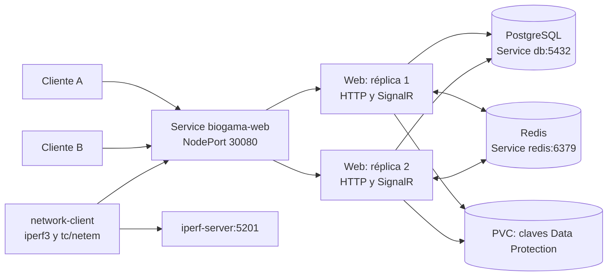

# BioGama Ecuador

Aplicación web de biodiversidad del Ecuador con registro de especies y avistamientos, investigadores, reservas naturales, productos, cursos e inventario. Este proyecto adapta la aplicación previa a un laboratorio distribuido con **Kubernetes, comunicación en tiempo real y evaluación de rendimiento, resiliencia, red, calidad y seguridad**.

**Estado documentado: 3 de noviembre de 2026 — America/Guayaquil.** Los resultados corresponden a las ejecuciones indicadas; no son garantías de capacidad ni de seguridad en producción.

Repositorio: [NoeliaMendoza/P2_Proyecto_BioGama_Ecuador](https://github.com/NoeliaMendoza/P2_Proyecto_BioGama_Ecuador).

> El laboratorio actual utiliza Kubernetes de Docker Desktop. `docker-stack.yml` y `deploy.ps1` pertenecen al despliegue histórico con Swarm. No son el procedimiento principal de este README. Antes de compartir el repositorio, verificar que la rama remota contenga los cambios locales: este trabajo no realiza commits ni publicaciones automáticamente.

## Contenido

1. [Objetivo y estado actual](#objetivo-y-estado-actual)
2. [Funciones y tecnologías](#funciones-y-tecnologías)
3. [Arquitectura del laboratorio](#arquitectura-del-laboratorio)
4. [Estructura del repositorio](#estructura-del-repositorio)
5. [Requisitos](#requisitos)
6. [Configuración](#configuración)
7. [Ejecución local](#ejecución-local)
8. [Despliegue en Kubernetes](#despliegue-en-kubernetes)
9. [Comunicación en tiempo real](#comunicación-en-tiempo-real)
10. [Pruebas automatizadas](#pruebas-automatizadas)
11. [Rendimiento con k6](#rendimiento-con-k6)
12. [Resiliencia](#resiliencia)
13. [Análisis de red](#análisis-de-red)
14. [Calidad con SonarQube](#calidad-con-sonarqube)
15. [Seguridad con OWASP ZAP](#seguridad-con-owasp-zap)
16. [Gestión de evidencias](#gestión-de-evidencias)
17. [Interpretación integral y limitaciones](#interpretación-integral-y-limitaciones)
18. [Entrega académica](#entrega-académica)
19. [Solución de problemas](#solución-de-problemas)
20. [Referencias y licencias](#referencias-y-licencias)

## Objetivo y estado actual

Implementar y evaluar una aplicación distribuida, relacionando comunicación en tiempo real, rendimiento, disponibilidad, recuperación ante fallos, condiciones de red, calidad del código y seguridad.

| Aspecto | Estado comprobado |
|---|---|
| Aplicación desplegada | `biogama-web:k8s-v10`, dos réplicas disponibles en el último despliegue verificado |
| Orquestación | Namespace `biogama`, Deployments, Services, probes y volúmenes persistentes |
| Tiempo real | SignalR con Redis; cambio de inventario recibido por clientes conectados a réplicas distintas |
| Pruebas C# | 110 aprobadas en la última suite registrada |
| JavaScript | 15 escenarios jsdom aprobados; tres archivos propios medidos con LCOV |
| Navegador real | Una prueba adicional con Chrome headless aislado, aprobada |
| SonarQube | Quality Gate **OK**; cobertura nueva 93,1 %, duplicación nueva 0 %, hallazgos nuevos 0 |
| Calidad global | 118 hallazgos abiertos, cobertura 19,8 %, duplicación 6,9 % |
| ZAP final | Dos variantes de alerta de riesgo medio pendientes, relacionadas con CSP |
| Entrega | Informe PDF y revisión de capturas/figuras aún deben completarse |

La referencia del último resultado SonarQube es [la exportación 20261103-134247-fccced](evidencias/20261103-134247-fccced/sonarqube/quality-gate.json). El análisis de código local es posterior al despliegue v10: el último cambio de sintaxis para acceder a cabeceras tipadas no se reconstruyó en otra imagen, aunque conserva sus valores y comportamiento.

## Funciones y tecnologías

### Funciones de la aplicación

- **Biodiversidad:** familias, especies, estado de conservación y avistamientos.
- **Trabajo de campo:** investigadores, reservas naturales y ubicaciones.
- **Ventas:** catálogo de productos, cursos, carrito, reservas de stock y cupos.
- **Administración:** entradas, salidas, ajustes y otros movimientos de inventario.
- **Tiempo real:** disponibilidad del catálogo actualizada sin recargar la página.
- **Identidad:** ASP.NET Core Identity, roles, controles de acceso y funcionalidades de MFA.
- **Integraciones configurables:** PayPal, PayPhone, correo SMTP y Ollama.

La existencia de una integración en el código no implica que esté desplegada o probada de extremo a extremo. Los manifiestos actuales no despliegan Ollama ni un worker de correo independiente. No se realizaron pagos reales; las pruebas automatizadas de proveedores usan simulaciones.

### Tecnologías utilizadas

| Componente | Tecnología |
|---|---|
| Backend y vistas | ASP.NET Core MVC / Razor, .NET 10 |
| Acceso a datos | Entity Framework Core y Npgsql |
| Base de datos | PostgreSQL 16 Alpine |
| Comunicación | SignalR, WebSockets y backplane Redis |
| Redis | Imagen `redis:7.4-alpine` |
| Orquestación local | Docker Desktop y Kubernetes |
| Pruebas C# | xUnit, ASP.NET Core TestServer/WebApplicationFactory, EF InMemory y Moq |
| Cobertura C# | Microsoft `dotnet-coverage`, instrumentación dinámica |
| Pruebas JavaScript | Node.js, jsdom y c8 |
| Rendimiento | k6 |
| Red | iperf3 y Linux `tc/netem` mediante netshoot |
| Calidad | SonarQube y SonarScanner for .NET |
| Seguridad dinámica | OWASP ZAP Baseline |
| HTML generado por IA | Marked y sanitización DOMPurify |

Las bibliotecas web añadidas para retirar dependencias de CDN se identifican en [security-dependencies.json](wwwroot/lib/security-dependencies.json), con versiones e integridades de sus paquetes. Sus licencias se conservan en las carpetas correspondientes.

## Arquitectura del laboratorio



Figura 1. Arquitectura lógica del laboratorio. El Service distribuye las solicitudes entre dos réplicas web; PostgreSQL conserva el estado del negocio y Redis distribuye las notificaciones de SignalR.

### Recursos de Kubernetes

| Recurso | Tipo / réplicas | Propósito |
|---|---|---|
| `biogama-web` | Deployment, 2 | Aplicación ASP.NET Core, puerto interno 8080 |
| `biogama-web` | Service NodePort | Acceso desde Windows por `127.0.0.1:30080` |
| `postgres` | Deployment, 1 | Base de datos persistente |
| `db` | Service, 5432 | Descubrimiento de PostgreSQL dentro del clúster |
| `redis` | Deployment, 1; Service, 6379 | Backplane de SignalR, sin persistencia configurada |
| `postgres-data` | PVC, 2 GiB | Datos de PostgreSQL |
| `web-keys` | PVC, 100 MiB | Claves compartidas de Data Protection |
| `iperf-server` | Pod y Service | Destino TCP/UDP del laboratorio de red |
| `network-client` | Pod | Generación de tráfico y degradación de su interfaz |

**Alcance físico:** todos los componentes evaluados comparten el nodo `docker-desktop`. Dos réplicas web permiten estudiar distribución y reemplazo de pods, pero no demuestran supervivencia a la caída del equipo o del nodo. PostgreSQL y Redis tienen una sola réplica.

Las claves compartidas de Data Protection permiten verificar cookies entre réplicas. Sin embargo, `AddDistributedMemoryCache()` mantiene la sesión en memoria de cada proceso: **no es una sesión centralizada en Redis o PostgreSQL**. El estado del negocio se guarda en PostgreSQL. El PVC `ReadWriteOnce` compartido funciona en este laboratorio de un solo nodo; no representa una configuración de almacenamiento lista para varios nodos.

## Estructura del repositorio

```text
BioGamaEcuador/
├── Areas/Identity/          # Registro, acceso y gestión de cuentas
├── Controllers/            # Controladores MVC y endpoints
├── Data/                   # DbContext, configuraciones, seeders y migraciones
├── Migrations/             # Migraciones históricas
├── Models/                 # Entidades y modelos de formularios
├── Services/               # Inventario, notificaciones, auditoría e integraciones
├── Hubs/                   # StockHub y ActivityHub
├── Middleware/             # Cabeceras de seguridad y nonce CSP
├── TagHelpers/             # Autorización de scripts Razor mediante nonce
├── Settings/               # Configuración de servicios externos
├── Workers/                # Worker de correo configurable
├── Views/                  # Vistas Razor y campos compartidos
├── wwwroot/
│   ├── css/                # Estilos propios
│   ├── js/                 # Stock, Markdown y controles de interfaz
│   └── lib/                # Bibliotecas web y licencias
├── k8s/                    # Manifiestos del laboratorio
├── tests/
│   ├── BioGamaEcuador.Tests/# Pruebas C#
│   ├── browser/            # Pruebas jsdom y Chrome
│   ├── python/             # Cobertura aislada de configuración del generador
│   ├── k6/                 # Escenarios y resultados de carga
│   ├── network/            # Evidencias iperf3 y HTTP normal/degradado
│   ├── realtime/           # Verificación con clientes en pods distintos
│   ├── quality/            # Resultados y notas de calidad
│   └── security/           # Ejecuciones y análisis de ZAP
├── evidencias/              # Instantáneas fechadas y manifiestos SHA-256
├── Dockerfile
├── BioGamaEcuador.csproj
├── BioGamaEcuador.sln
├── Program.cs
└── appsettings.example.json
```

`.local/` contiene herramientas, resultados temporales y perfiles aislados del entorno; está excluido de Git y de la imagen Docker. No contiene archivos necesarios para describir el código del producto.

La carpeta `scripts/` se conserva únicamente en el equipo de trabajo y está excluida de Git. Los comandos `.\scripts\...` que aparecen más adelante describen las ayudas utilizadas en ese entorno; no estarán disponibles al clonar el repositorio. Las pruebas versionadas y los comandos directos de sus herramientas se documentan por separado.

## Requisitos

Para reproducir el laboratorio documentado:

- Windows con PowerShell y Docker Desktop usando contenedores Linux.
- Kubernetes habilitado en Docker Desktop; `kubectl` apuntando al contexto correcto.
- SDK .NET 10.0.403 o un parche compatible de la misma banda, según `global.json`, y acceso a los paquetes NuGet al restaurar.
- Node.js y npm; `.node-version` registra Node.js 24.22.0, usado en las pruebas.
- k6 para las pruebas de rendimiento; la medición inicial registró k6 2.2.0.
- SonarQube accesible y SonarScanner for .NET instalado; se utilizó el escáner 12.0.
- Docker disponible para ZAP y la comprobación Python aislada.
- Chrome en su ruta normal de Windows para la prueba adicional de navegador real.

Comprobación inicial, sin modificar el clúster:

```powershell
dotnet --info
node --version
npm.cmd --version
docker version
kubectl config current-context
kubectl get nodes
k6 version
dotnet tool list --global
```

Los comandos de este README se ejecutan desde la raíz del repositorio. Las pruebas de carga, eliminación de pods y degradación de red corresponden exclusivamente al entorno de laboratorio.

## Configuración

La plantilla [appsettings.example.json](appsettings.example.json) describe la conexión inicial. Las credenciales reales se configuran mediante User Secrets, variables de entorno o Kubernetes Secrets y no se publican en el repositorio.

| Clave de configuración | Uso |
|---|---|
| `ConnectionStrings:DefaultConnection` | Conexión PostgreSQL |
| `ConnectionStrings:Redis` | Backplane SignalR; opcional para una instancia local |
| `Database:InitializeOnStartup` | Migraciones y seeders al iniciar; `false` en el despliegue estable |
| `DataProtection:KeysPath` | Directorio de claves persistentes |
| `APP_VERSION` | Identificación de versión en `/api/info` |
| `TZ` | Zona horaria del contenedor |
| `SeedUsers:*Password` | Claves de cuentas iniciales, sin valores predeterminados |
| `PayPal:ClientId`, `PayPal:ClientSecret`, `PayPal:BaseUrl` | Integración PayPal; BaseUrl predeterminada de Sandbox |
| `PayPhone:Token`, `PayPhone:StoreId` | Integración PayPhone |
| `Ollama:BaseUrl`, `Ollama:Model`, `Ollama:TimeoutSeconds` | Servicio y modelo de IA |
| `EmailSettings:*` | Servicio SMTP |
| `Authentication:Google:ClientId`, `Authentication:Google:ClientSecret` | Acceso Google, habilitado solo si ambas claves existen |

En variables de entorno, `:` se sustituye por `__`, por ejemplo `ConnectionStrings__Redis`.

### Cuentas iniciales

| Cuenta | Variable de entorno | Rol |
|---|---|---|
| `admin@biogama.ec` | `SeedUsers__AdminPassword` | Administrador |
| `investigador@biogama.ec` | `SeedUsers__ResearcherPassword` | Investigador |
| `usuario@biogama.ec` | `SeedUsers__PublicPassword` | UsuarioPublico |

Sin clave configurada, se omite la creación de esa cuenta y se registra una advertencia. Para un administrador adicional se configuran `SeedUsers__AdditionalAdminEmail` y `SeedUsers__AdditionalAdminPassword`. El seeder conserva las claves y los roles de cuentas existentes.

`datos.py` obtiene su conexión de `PGHOST`, `PGPORT`, `PGDATABASE`, `PGUSER` y `PGPASSWORD`. **Es un generador de datos masivos, no un paso de instalación ni una prueba de humo.** No ejecutarlo sobre la base medida para este informe sin preparar otro conjunto de datos.

## Ejecución local

```powershell
git clone https://github.com/NoeliaMendoza/P2_Proyecto_BioGama_Ecuador.git
cd P2_Proyecto_BioGama_Ecuador
dotnet restore BioGamaEcuador.sln
dotnet build BioGamaEcuador.sln
```

Preparar una base PostgreSQL accesible y configurar una conexión propia. El siguiente comando es una plantilla; `<CLAVE_LOCAL>` no es una credencial del proyecto:

```powershell
dotnet user-secrets set "ConnectionStrings:DefaultConnection" "Host=localhost;Port=5432;Database=biogama_ecuador;Username=biogama_user;Password=<CLAVE_LOCAL>"
$env:ASPNETCORE_ENVIRONMENT = 'Development'
$env:DataProtection__KeysPath = Join-Path (Get-Location) '.local/keys'
dotnet run --project BioGamaEcuador.csproj --urls http://localhost:5080
```

Evitar pegar credenciales reales en capturas o chats y tener en cuenta el historial de terminal al configurar secretos. Los User Secrets se almacenan fuera del repositorio.

Si no se cambia `Database:InitializeOnStartup`, el valor predeterminado es `true`: se aplican migraciones y seeders al arrancar. Usar este comportamiento únicamente para inicializar una base controlada. La creación de cuentas requiere sus claves configuradas. Para varias réplicas, inicializar primero con una sola y desactivar esa opción después.

Ollama, SMTP, Google y los proveedores de pago requieren su propia configuración. `localhost` desde un pod o contenedor se refiere a ese pod/contenedor, no al equipo Windows ni a otro servicio.

## Despliegue en Kubernetes

Manifiestos: [k8s/](k8s/). La imagen del Deployment actual es `biogama-web:k8s-v10`, con `imagePullPolicy: Never`, apropiada para la imagen construida en el Docker Desktop de este laboratorio. En otro clúster se necesita publicar una imagen en un registro y adaptar esa política y su referencia.

### Laboratorio ya inicializado

Con la base, el Secret `biogama-db` y los volúmenes existentes:

```powershell
docker build -t biogama-web:k8s-v10 .
kubectl apply -f k8s/00-namespace.yaml
kubectl apply -f k8s/01-postgres.yaml
kubectl apply -f k8s/03-redis.yaml
kubectl apply -f k8s/02-web.yaml
kubectl rollout status deployment/biogama-web -n biogama --timeout=180s
```

Para cambios posteriores, utilizar **otra etiqueta de imagen** y actualizar tanto `image` como `APP_VERSION` en `02-web.yaml`. Reutilizar una etiqueta puede dejar pods ejecutando una imagen anterior; además dificulta relacionar pruebas con versiones.

### Primera instalación: Secret y esquema

El manifiesto PostgreSQL requiere un Secret llamado `biogama-db`, con clave `db_password`. El mismo valor se monta en `/run/secrets/db_password` para la aplicación. Debe crearse antes de iniciar los contenedores. En una base persistente existente, recrear el Secret con otra clave **no cambia automáticamente la clave del usuario PostgreSQL**.

Ejemplo de creación inicial mediante entrada oculta y archivo temporal, sin escribir la clave en el comando de `kubectl`:

```powershell
kubectl apply -f k8s/00-namespace.yaml
New-Item -ItemType Directory -Path .local -Force | Out-Null
$secretPath = Join-Path (Get-Location) '.local/db-password-inicial.txt'
$securePassword = Read-Host 'Clave para la base NUEVA' -AsSecureString
try {
    $password = [Net.NetworkCredential]::new('', $securePassword).Password
    [IO.File]::WriteAllText($secretPath, $password, [Text.UTF8Encoding]::new($false))
    kubectl create secret generic biogama-db -n biogama --from-file="db_password=$secretPath"
} finally {
    $password = $null
    $securePassword.Dispose()
    if (Test-Path -LiteralPath $secretPath) { Remove-Item -LiteralPath $secretPath }
}
```

Este ejemplo es para un Secret que aún no existe. No elimina ni reemplaza credenciales existentes. Kubernetes Secrets no equivalen por sí solos a cifrado en reposo.

Para una base vacía, el manifiesto estable tiene desactivada la inicialización. Puede prepararse una copia temporal con una sola réplica y la inicialización activada:

```powershell
kubectl apply -f k8s/01-postgres.yaml
kubectl rollout status deployment/postgres -n biogama --timeout=180s
kubectl apply -f k8s/03-redis.yaml

$bootstrap = Get-Content k8s/02-web.yaml -Raw
$bootstrap = $bootstrap.Replace('replicas: 2', 'replicas: 1')
$bootstrap = $bootstrap.Replace('value: "false"', 'value: "true"')
$bootstrap | Set-Content .local/web-bootstrap.yaml -Encoding UTF8
kubectl apply -f .local/web-bootstrap.yaml
kubectl rollout status deployment/biogama-web -n biogama --timeout=180s

# Tras comprobar la inicialización, volver a dos réplicas sin migraciones al arrancar.
kubectl apply -f k8s/02-web.yaml
kubectl rollout status deployment/biogama-web -n biogama --timeout=180s
```

La sustitución anterior corresponde al contenido actual de `02-web.yaml`; revisar la copia si el manifiesto cambia. Si se necesitan cuentas iniciales, incorporar **antes del arranque de inicialización** sus variables desde un Secret propio. El manifiesto no distribuye claves predeterminadas ni crea automáticamente una cuenta administradora sin configuración.

Ejemplo del enlace de una variable, que debe añadirse a `env` en la copia de inicialización si se creó ese Secret:

```yaml
- name: SeedUsers__AdminPassword
  valueFrom:
    secretKeyRef:
      name: biogama-seed-users
      key: admin_password
```

### Comprobación del servicio

```powershell
kubectl get deployments,pods,services,pvc -n biogama
kubectl get pods -n biogama -o wide
Invoke-RestMethod http://127.0.0.1:30080/health
Invoke-RestMethod http://127.0.0.1:30080/health/ready
Invoke-RestMethod http://127.0.0.1:30080/api/info
```

Abrir [el catálogo](http://127.0.0.1:30080/Products). `/health` comprueba que el proceso responde; `/health/ready` comprueba conectividad con la base, **no** la existencia de todo el esquema ni cada operación del negocio. Verificar también una página que consulte datos.

## Comunicación en tiempo real

### Flujo de disponibilidad

1. El administrador registra un movimiento en `/Admin/Inventory`.
2. Se valida y guarda el cambio en PostgreSQL.
3. Después del commit se publica el evento `StockChanged` mediante SignalR.
4. Redis distribuye la notificación entre las dos réplicas web.
5. Los navegadores consultan `/Products/Availability` con sus filtros y página.
6. Se actualizan unidades, total disponible, estado y límites de compra sin recargar.

El evento incluye identificador, fecha UTC y pod emisor; no contiene datos del comprador. Es una **invalidación** para consultar el estado vigente, en vez de aplicar deltas que podrían repetirse o llegar fuera de orden. Las consultas del cliente se serializan y se resincronizan al reconectar, recuperar foco y periódicamente.

| Ruta | Función |
|---|---|
| `/Products` | Catálogo con disponibilidad en vivo |
| `/Products/Availability` | Estado actual para filtros y paginación |
| `/hubs/stock` | Hub SignalR de inventario |
| `/hubs/activity` | Hub de actividad |
| `/Realtime` | Redirección al catálogo |
| `/api/info` | Versión y pod que responde |

### Verificación con varios clientes

Abrir el catálogo en dos navegadores. En otra sesión administrativa, registrar una entrada de una unidad y observar el cambio sin recargar; después registrar una salida compensatoria del mismo producto.

También existe una verificación automatizada:

```powershell
$admin = Get-Credential -UserName admin@biogama.ec -Message 'Cuenta administradora del laboratorio'
.\tests\realtime\verify.ps1 -AdminCredential $admin
```

Esta prueba **sí registra movimientos reales de laboratorio**: conecta dos clientes WebSocket en pods distintos, comprueba disponibilidad de 30 a 31 y vuelve a 30 mediante una salida compensatoria. Los movimientos quedan en auditoría; ejecutarla sin cambios concurrentes de inventario. Referencia: [stock-verification.txt](tests/realtime/stock-verification.txt) y [descripción del flujo](tests/realtime/README.md).

Las notificaciones no son durables. Si Redis falla, un cambio confirmado no se revierte por no poder notificarse, y la resincronización permite recuperar el estado. Un único Redis sigue siendo un punto de fallo. Total y lista se consultan por separado; no constituyen una instantánea atómica.

## Pruebas automatizadas

```powershell
dotnet test tests/BioGamaEcuador.Tests/BioGamaEcuador.Tests.csproj
```

La suite C# cubre validación de inventario, cuentas iniciales, registros, propiedad de pagos, antifalsificación, respuestas del proveedor simuladas, catálogo, formularios Razor, campos obligatorios, cabeceras y nonce CSP. El último resultado verificado fue **110 aprobadas**; futuras ejecuciones deben conservar su propio resultado.

### Cobertura y navegador

Las ayudas `Invoke-*.ps1` del siguiente bloque son locales y no se publican. Para ejecutar las pruebas C# del repositorio clonado, usar el comando `dotnet test` anterior; la prueba adicional Chrome tiene su comando directo al final del bloque. La generación de cobertura requiere preparar las herramientas indicadas en los archivos de pruebas.

```powershell
# Requiere compilación previa y la herramienta local preparada por Analyze-And-Save.
.\scripts\Invoke-CoverageTests.ps1

# Pruebas JS propias e informe LCOV.
.\scripts\Invoke-BrowserTests.ps1

# Solo configuración del generador Python, en contenedor sin red.
.\scripts\Invoke-PythonTests.ps1

# Comprobación adicional con Chrome real; aplicación desplegada en 30080.
node --test tests/browser/security-browser-check.test.cjs
```

| Verificación | Resultado documentado | Límite |
|---|---|---|
| C# / xUnit | 110 aprobadas | Proveedores simulados y base InMemory en pruebas de aplicación |
| JS / jsdom | 15 escenarios aprobados | No es un navegador que aplique CSP |
| LCOV | 100 % en `product-stock.js`, `markdown-renderer.js` y `ui-actions.js` | No equivale a 100 % de la aplicación |
| Node / Chrome | Una prueba adicional aprobada | Catálogo e IA públicos; sin pagos reales |
| Python | Configuración desde entorno y rechazo de clave ausente | No ejecuta el generador masivo |

Chrome utiliza un perfil nuevo en `.local`, comprueba stock conectado, ausencia de bloqueos CSP y selector IA con texto malicioso sintético solo en el navegador. Sustituye temporalmente el manejador del botón IA para comprobar su enlace sin llamar al servicio.

En dos pruebas de transición de pagos se permite explícitamente simular transacciones de EF InMemory. Esas pruebas verifican estado e idempotencia secuencial, **no** rollback, concurrencia ni atomicidad PostgreSQL. La compatibilidad del nonce del SDK no equivale a una compra PayPal Sandbox completa.

## Rendimiento con k6

Escenarios: [smoke-test.js](tests/k6/smoke-test.js) y [baseline-test.js](tests/k6/baseline-test.js).

- Smoke: 1 usuario virtual, 10 segundos, comprobación de respuesta.
- Baseline: 100 usuarios virtuales, 30 segundos, pausa de 0,1 s por iteración.
- Umbrales baseline: errores HTTP menores a 1 %, `p(95) < 250 ms` y todas las comprobaciones de estado aprobadas.
- Es un modelo de usuarios constantes, no una tasa fija de solicitudes.

Guardar cada repetición en una carpeta nueva para conservar el resultado anterior:

```powershell
$run = Get-Date -Format 'yyyyMMdd-HHmmss'
$results = "tests/k6/results/$run"
New-Item -ItemType Directory -Path $results -Force | Out-Null
k6 run -e BASE_URL=http://127.0.0.1:30080 --summary-export "$results/smoke.json" tests/k6/smoke-test.js
k6 run -e BASE_URL=http://127.0.0.1:30080 --summary-export "$results/baseline-info.json" tests/k6/baseline-test.js
k6 run -e BASE_URL=http://127.0.0.1:30080 -e TEST_PATH=/Products --summary-export "$results/baseline-products.json" tests/k6/baseline-test.js
```

El exportador de evidencias copia los resultados k6 que están directamente en `tests/k6/results`. Para repeticiones guardadas en subcarpetas, incorporar esa carpeta de ejecución al conjunto de evidencias y regenerar su manifiesto; no asumir que se copió automáticamente.

### Medición inicial documentada

Fecha: 2 de noviembre de 2026; imagen **k8s-v2**, dos réplicas, tres productos y cero especies, sin degradación deliberada. Generador y servicios compartían el equipo. Estos escenarios **no se repitieron sobre v10**.

| Ruta | Peticiones | Solicitudes/s | Media ms | p(95) ms | Errores HTTP |
|---|---:|---:|---:|---:|---:|
| `/api/info` | 28.172 | 935,89 | 5,59 | 13,29 | 0 % |
| `/Products` | 5.995 | 198,43 | 401,12 | 717,93 | 1/5.995, aprox. 0,0167 % |

Tabla 1. Resultados de los baseline originales. `/Products` consulta datos y genera HTML; `/api/info` solo devuelve metadatos. La diferencia muestra costos de operaciones distintas, pero no permite atribuir todo el retraso a PostgreSQL.

Smoke obtuvo diez respuestas válidas y p(95) de 9,67 ms. `/Products` incumplió el umbral de latencia y la comprobación de todas las respuestas 200. Su salida de k6 distinta de cero es un resultado que debe analizarse, no un problema de instalación. No se determinó la causa exacta de la respuesta fallida.

Fuentes: [JSON y análisis originales](tests/k6/results/) y [método](tests/k6/README.md). Las pruebas HTTP k6 no ejecutan JavaScript ni prueban por sí solas el flujo visual de tiempo real. Una ejecución no establece la capacidad máxima de la aplicación.

## Resiliencia

Se observó la eliminación de una réplica web, la creación de un pod sustituto y el retorno a dos réplicas disponibles. Las capturas compartidas mostraron al sustituto listo aproximadamente a los once segundos de su creación, y respuestas OK durante la ventana mostrada por el monitor.

Esta observación **no es una medición formal de RTO ni disponibilidad absoluta**. Para una repetición documentada, conservar el registro de solicitudes antes, durante y después de la eliminación, con cantidad de errores y duración de la ventana.

En una terminal:

```powershell
kubectl get pods -n biogama -l app=biogama-web -w
```

En otra, mantener un monitor; detener con `Ctrl+C`:

```powershell
while ($true) {
    $hora = Get-Date -Format 'HH:mm:ss.fff'
    try {
        $r = Invoke-RestMethod 'http://127.0.0.1:30080/api/info' -TimeoutSec 3
        Write-Output "$hora OK $($r.version) $($r.pod)"
    } catch {
        Write-Output "$hora ERROR"
    }
    Start-Sleep -Milliseconds 300
}
```

Con dos réplicas disponibles, eliminar **solo un pod web del laboratorio** y observar su sustitución:

```powershell
$pod = kubectl get pods -n biogama -l app=biogama-web -o 'jsonpath={.items[0].metadata.name}'
kubectl delete pod $pod -n biogama
kubectl rollout status deployment/biogama-web -n biogama --timeout=180s
kubectl get deployments,pods -n biogama
```

No eliminar los PVC para esta prueba. La recuperación de un pod no demuestra recuperación ante caída del nodo ni conmutación de PostgreSQL/Redis. Revisar que las capturas reales de esta prueba estén disponibles para el informe: parte de ellas se compartió únicamente en el chat.

## Análisis de red

Preparación:

```powershell
kubectl apply -f k8s/04-network-lab.yaml
kubectl get pods -n biogama -o wide
kubectl exec -n biogama network-client -- tc qdisc show dev eth0
```

`NET_ADMIN` se concede solo al cliente de laboratorio. La degradación afecta su salida por `eth0`, no la red de Windows ni directamente a los clientes del navegador.

### Condición normal y degradada

```powershell
$run = Get-Date -Format 'yyyyMMdd-HHmmss'
kubectl exec -n biogama network-client -- iperf3 -c iperf-server -t 10 | Tee-Object "tests/network/iperf-normal-$run.txt"
kubectl exec -n biogama network-client -- iperf3 -c iperf-server -u -b 10M -t 10 | Tee-Object "tests/network/udp-normal-$run.txt"

try {
    kubectl exec -n biogama network-client -- tc qdisc replace dev eth0 root netem delay 100ms loss 2%
    kubectl exec -n biogama network-client -- iperf3 -c iperf-server -t 10 | Tee-Object "tests/network/iperf-degradado-$run.txt"
    kubectl exec -n biogama network-client -- iperf3 -c iperf-server -u -b 10M -t 10 | Tee-Object "tests/network/udp-degradado-$run.txt"
} finally {
    kubectl exec -n biogama network-client -- tc qdisc del dev eth0 root
    kubectl exec -n biogama network-client -- tc qdisc show dev eth0
}
```

Comprobar los códigos de salida de los comandos nativos durante una ejecución real. Si se interrumpe la terminal antes de limpiar, retirar netem y volver a consultar el estado. `noqueue` indica que no queda esa regla; intentar borrarlo puede producir `Cannot delete qdisc with handle of zero`.

Medir también HTTP desde **el mismo cliente**, antes y durante la degradación:

```powershell
1..10 | ForEach-Object {
    kubectl exec -n biogama network-client -- curl -sS -o /dev/null -w '%{http_code} %{time_total}\n' http://biogama-web:8080/Products
}
```

### Resultados conservados

| Indicador | Normal | Degradado: 100 ms y 2 % de pérdida configurada |
|---|---:|---:|
| TCP, throughput del receptor | 25,4 Gbit/s | 2,70 Mbit/s |
| UDP, throughput del receptor, oferta 10 Mbit/s | 10,0 Mbit/s | 9,72 Mbit/s |
| Pérdida UDP del receptor | 0 % | Aproximadamente 1,8 % |
| Jitter UDP | 0,056 ms | 0,194 ms |
| `/Products`, media HTTP | 10,79 ms | 364,60 ms |
| `/Products`, máximo HTTP | 15,32 ms | 424,15 ms |
| Respuestas HTTP 200 | 10/10 | 10/10 |

Tabla 2. Comparación de red. La media HTTP creció aproximadamente 33,8 veces mientras la aplicación siguió respondiendo en las muestras recogidas: disponibilidad y rendimiento son propiedades distintas.

El jitter mide variación, no la latencia absoluta introducida. El throughput entre pods del mismo nodo no mide la velocidad de Internet. No comparar conteos de retransmisiones aislados cuando cambian los volúmenes transferidos. Diez solicitudes no equivalen al baseline k6 ni permiten generalizar disponibilidad.

Evidencias y análisis: [tests/network](tests/network/analisis.md).

## Calidad con SonarQube

### Ejecución y exportación

En el equipo de trabajo, con la ayuda local disponible, SonarQube en `http://127.0.0.1:9000` y el escáner instalado:

```powershell
.\scripts\Analyze-And-Save.ps1
```

El script solicita un token con entrada oculta, valida servidor y autenticación, inicia análisis, compila, ejecuta pruebas/cobertura C#, JavaScript y Python, publica y espera el procesamiento antes de exportar. No publica como exitoso un análisis cuyo paso de pruebas haya fallado.

Utilizar una credencial con los permisos necesarios para analizar y leer el proyecto. No pegar tokens en chats ni capturas. Las API de historial y desglose por archivo devolvieron HTTP 403 en este entorno; Gate, métricas y hallazgos sí se exportaron. Esa limitación queda en `diagnostico-exportacion.json` y no invalida por sí sola las consultas que sí terminaron.

### Comparación documentada

| Métrica | Primera captura | Última exportación confirmada |
|---|---:|---:|
| Hallazgos abiertos globales | 219 | 118 |
| Cobertura global reportada | 0 % | 19,8 % |
| Duplicación global | 8,7 % | 6,9 % |
| Cobertura del código nuevo | No indicada en esa captura | 93,1 % |
| Duplicación del código nuevo | No indicada en esa captura | 0 % |
| Hallazgos nuevos | No indicados en esa captura | 0 |
| Quality Gate final | — | OK |

Tabla 3. Evolución de calidad. La primera captura es evidencia visual aportada durante el trabajo; la última exportación está en [20261103-134247-fccced](evidencias/20261103-134247-fccced/sonarqube/). El Gate evalúa sus condiciones configuradas y no certifica ausencia de defectos en toda la aplicación.

La cobertura creció por pruebas adicionales, importación correcta de reportes y ajustes del alcance. El 0 % inicial era el valor reportado, no prueba de que no existiera ninguna prueba. No atribuir todo el aumento únicamente a ejecutar más código.

### Mejoras realizadas

- Actualización de dependencias NuGet señaladas, sin suprimir advertencias NU190x.
- Credenciales iniciales y del generador fuera del código; conservación de cuentas existentes.
- Operaciones asíncronas y correcciones de nulabilidad y configuración EF.
- Antifalsificación en operaciones de pago y controles de pertenencia de recursos.
- Verificación del webhook PayPhone con datos del proveedor, importe, moneda y estado.
- Validación de cantidades, reservas, ajustes y campos numéricos/fechas omitidos.
- Formularios de creación sin Id enviado por el usuario; edición con identificación requerida.
- Campos Razor compartidos para cinco pares crear/editar, reduciendo duplicación real.
- Etiquetas accesibles y encabezados de tablas.
- Cabeceras tipadas y prueba Chrome registrada formalmente con `node:test`.

La cobertura C# usa instrumentación dinámica de Microsoft porque Coverlet encontró un bloqueo de Windows App Control. **No se deshabilitaron políticas de seguridad del sistema.**

Los reportes de cobertura/ZAP y copias de evidencias no se analizan como código del producto. Scripts de prueba Python/k6 se separan del cálculo de cobertura de producción. Las nuevas bibliotecas externas se distinguen del código propio. No se rebajaron umbrales ni se excluyeron controladores, servicios o JS propio para aprobar el Gate. Las migraciones históricas se conservaron.

Los cambios de alcance deben explicarse por separado de las correcciones de código. Referencias: [notas de calidad](tests/quality/), [alcance](tests/quality/coverage-scope-correction.md) y [últimas correcciones del Gate](tests/quality/gate-followup-csp.md).

## Seguridad con OWASP ZAP

### Método reproducible

El comando `Invoke-ZapBaseline.ps1` pertenece a las ayudas locales excluidas de Git. El procedimiento que ejecuta y sus opciones están descritos en [el método de seguridad](tests/security/README.md); clonar el repositorio no proporciona ese script auxiliar.

```powershell
docker pull ghcr.io/zaproxy/zaproxy:stable
.\scripts\Invoke-ZapBaseline.ps1
```

La ejecución documentada utiliza ZAP 2.17.0. Se conserva el identificador de la imagen en los metadatos, porque `stable` puede cambiar. El script es específico del laboratorio Docker Desktop: comparte la red de una réplica web, comprueba el catálogo HTML y analiza `http://127.0.0.1:8080` dentro de esa red.

Es un baseline **anónimo y pasivo**, con spider tradicional de un minuto, sin envío de formularios ni escaneo activo. No cubre una sesión autenticada, una compra completa ni un dominio HTTPS público. La primera ejecución mediante `host.docker.internal` falló por DNS y se conservó como no concluyente; sus cero alertas no se usan como evidencia de seguridad.

### Comparación de resultados

| Ejecución | Imagen | URLs baseline | Alertas medias individuales | Bajas |
|---|---|---:|---:|---:|
| Inicial válida | k8s-v7 | 53 | 3 | 2 |
| Primera corrección | k8s-v8 | 65 | 3 diferentes | 0 |
| Final | k8s-v10 | 66 | 2 | 0 |

Tabla 4. Evolución de ZAP. Las cinco alertas iniciales ya no aparecen: faltaban CSP, protección anti-clickjacking y `nosniff`, y se señalaban recursos externos sin SRI y JavaScript de otro dominio. Las nuevas advertencias se refieren a restricciones todavía permisivas de la CSP; no son las mismas tres alertas medias iniciales.

| Referencia pendiente | Riesgo | Componentes afectados | Recomendación |
|---|---|---|---|
| `10055-4`, CSP: Wildcard Directive | Medio | Cabecera CSP de las páginas; `img-src` admite cualquier origen HTTPS | Inventariar los dominios reales de imágenes y definir una lista específica |
| `10055-6`, CSP: style-src unsafe-inline | Medio | Vistas y estilos actuales | Migrar estilos en línea a clases/archivos o usar nonces donde corresponda |

Tabla 5. Pendientes de seguridad del baseline final. La consola agrupa ambas variantes bajo regla `10055` y puede mostrar `WARN=1`; el JSON distingue **dos** alertas medias. Las observaciones informativas de sesión y comentarios de una librería se interpretan aparte.

Se retiró `unsafe-inline` de `script-src` y se usa un nonce aleatorio de 32 bytes por respuesta. La TagHelper lo aplica a los scripts confiables de Razor y al SDK de PayPal; los eventos `onclick`/`onsubmit` pasaron a listeners. El HTML usa `no-store` para evitar reutilizar un documento con una política de otro nonce.

El Markdown de IA se sanitiza mediante DOMPurify, y el selector escapa nombres antes de construir HTML. Las pruebas de navegador comprobaron que la CSP no bloquea el catálogo y la interfaz IA. No se hicieron pagos reales para esa comprobación.

El reporte final registra 31 % de fallos de red en sus insights. El alcance no es una auditoría completa; ausencia de alertas altas no significa ausencia de vulnerabilidades altas. Los códigos de salida del baseline son `0` sin FAIL/WARN según la configuración, `1` con FAIL, `2` con WARN sin FAIL y `3` para otros errores. No confundir una alerta con un fallo de infraestructura.

Fuentes: [reporte final HTML](tests/security/zap/20261103-130039-88393e/reporte.html), [comparación final CSP](tests/security/zap/20261103-130039-88393e/comparacion-csp.md), [comparación v7/v8](tests/security/zap/20261103-124617-d2a5ca/comparacion.md) y [método de seguridad](tests/security/README.md).

## Gestión de evidencias

La exportación siguiente utiliza una ayuda conservada localmente, no incluida en el repositorio. Las carpetas de resultados y sus instantáneas existentes pueden consultarse sin ejecutarla.

```powershell
# Copia local de los resultados existentes; no repite carga ni necesita token.
.\scripts\Export-Evidence.ps1 -LocalOnly

# Exporta además SonarQube y solicita credencial de lectura oculta.
.\scripts\Export-Evidence.ps1
```

Cada ejecución crea `evidencias/<fecha-identificador>/`, con hora de Ecuador, resultados, diagnósticos y manifiesto SHA-256. El exportador recoge archivos seleccionados de k6, red, tiempo real y calidad, así como las carpetas de ejecuciones ZAP. No copia automáticamente cualquier archivo o subcarpeta nueva de resultados.

### Referencias útiles

| Evidencia | Ubicación |
|---|---|
| k6 original | [tests/k6/results](tests/k6/results/) |
| Comparación de red | [tests/network/analisis.md](tests/network/analisis.md) |
| Clientes de tiempo real | [tests/realtime/stock-verification.txt](tests/realtime/stock-verification.txt) |
| Últimas pruebas C# | [tests/quality/test-results-summary.json](tests/quality/test-results-summary.json); TRX completo conservado localmente |
| JavaScript y cobertura | [tests/quality/browser-tests.txt](tests/quality/browser-tests.txt) |
| Chrome real | [tests/quality/browser-security-check.json](tests/quality/browser-security-check.json) |
| SonarQube final confirmado | [evidencias/20261103-134247-fccced/sonarqube](evidencias/20261103-134247-fccced/sonarqube/) |
| ZAP final | [tests/security/zap/20261103-130039-88393e](tests/security/zap/20261103-130039-88393e/) |

Los archivos en `tests/quality` pueden cambiar al repetir pruebas; para citar una ejecución, preferir su instantánea fechada. Las capturas deben ser reales, con título, numeración y explicación. Agregarlas a `capturas` después de exportar **no actualiza automáticamente** el manifiesto anterior: regenerarlo al cerrar el conjunto final, sin presentarlo como si ya cubriera las imágenes añadidas después.

Git publica un subconjunto de las evidencias: consultas SonarQube y resultados de pruebas seleccionados. Las exportaciones completas y los informes grandes permanecen locales. Consultar [evidencias/README.md](evidencias/README.md) para distinguir el contenido publicado del archivo local.

Las convenciones de ramas, commits, pruebas y etiquetas están en [CONTRIBUTING.md](CONTRIBUTING.md).

## Interpretación integral y limitaciones

- **Rendimiento y red:** el catálogo tiene un costo mayor que `/api/info`; netem aumenta la latencia aunque las solicitudes de la muestra sigan respondiendo.
- **Resiliencia y disponibilidad:** las réplicas y las probes permiten reemplazar pods, pero la base, Redis y el nodo siguen siendo dependencias únicas.
- **Tiempo real y consistencia:** los eventos aceleran la actualización visual; la consulta a PostgreSQL y la resincronización son necesarias si se pierde una notificación.
- **Calidad y mantenibilidad:** compartir campos y validar solicitudes evita errores y facilita cambios; aprobar el Gate no elimina la deuda global.
- **Seguridad y funcionamiento:** cabeceras, sanitización y nonces reducen riesgos, pero deben probarse para no bloquear dependencias o controles legítimos.
- **Validez de la comparación:** los ensayos se realizaron sobre versiones diferentes. No atribuir a v10 los resultados k6 de v2 ni afirmar mejoras de rendimiento que no se midieron.

Antes de un entorno de producción o una conclusión más amplia, quedan pendientes sesiones centralizadas si se requieren, TLS y configuración de proxy, tolerancia a fallos de base/Redis/nodo, ejecución sin root y mayor restricción de privilegios del contenedor, pruebas de concurrencia con PostgreSQL y verificación completa de integraciones externas. Estos puntos no se presentan como implementados.

## Entrega académica

**Proyecto:** Integración de comunicación distribuida en tiempo real — Rendimiento, resiliencia, calidad y seguridad.

- Apertura: martes 27 de octubre de 2026, 09:00.
- Cierre: jueves 5 de noviembre de 2026, 11:00.
- Zona de referencia: America/Guayaquil.
- Entrega: **un único PDF** llamado `Proyecto_AD_ApellidosyNombre.pdf`.

El README y el paquete de contexto no sustituyen el informe. Verificar la siguiente estructura:

- [ ] 1. Portada con los datos reales del grupo.
- [ ] 2. Índice general.
- [ ] 3. Índice de figuras.
- [ ] 4. Índice de tablas.
- [ ] 5. Introducción.
- [ ] 6. Objetivos.
- [ ] 7. Descripción general de la aplicación.
- [ ] 8. Arquitectura distribuida propuesta y alcance real.
- [ ] 9. Enlace al repositorio actualizado y evidencia de estructura.
- [ ] 10. Kubernetes: contenedores, Deployments, Pods, Services, réplicas y funcionamiento.
- [ ] 11. Tiempo real: tecnología, flujo, mensajes y múltiples clientes.
- [ ] 12. k6: configuración, VUs, latencias, p95, errores, solicitudes/s e interpretación.
- [ ] 13. Resiliencia: fallo, recuperación, réplicas y disponibilidad observada.
- [ ] 14. Red: iperf3, latencia/pérdida, comparación y efecto sobre la aplicación.
- [ ] 15. SonarQube: resultados, problemas, mejora demostrada y antes/después.
- [ ] 16. ZAP: alertas, riesgo, endpoints y recomendaciones.
- [ ] 17. Análisis integral de rendimiento, resiliencia, red, calidad y seguridad.
- [ ] 18. Conclusiones basadas en las mediciones.
- [ ] 19. Recomendaciones y pendientes.
- [ ] 20. Referencias bibliográficas.

Cada figura, gráfico y tabla debe numerarse, titularse, mencionarse y explicarse en el texto. Los fragmentos de código deben aportar al análisis, conservar indentación, usar fuente monoespaciada y evitar archivos completos innecesarios. Verificar que las capturas de resiliencia y tiempo real compartidas en el chat se hayan guardado como archivos antes de cerrar el PDF.

No se exige llevar todos los contadores a cero. Sí se exige documentar resultados, mejoras, problemas y limitaciones con análisis propio.

## Solución de problemas

| Síntoma | Qué revisar |
|---|---|
| `kubectl` no conecta | Docker Desktop, Kubernetes habilitado y contexto de `kubectl` |
| `ImagePullBackOff` / `ErrImageNeverPull` | Imagen exacta construida en el runtime del clúster; el manifiesto usa `Never` |
| Base no autentica tras cambiar un Secret | La clave del usuario persistente no cambia al recrear el Secret |
| Pod listo pero catálogo falla | Esquema, migraciones y logs: readiness solo comprueba conexión |
| No existe cuenta administradora nueva | Clave de seeding ausente o inicialización desactivada; no hay clave predeterminada |
| No cambia stock entre clientes | Hub, Redis, conectividad, consola del navegador y endpoint Availability |
| Error al borrar `noqueue` | Verificar estado: puede no existir netem para retirar |
| k6 termina con código 1 | Leer umbrales y checks; conservar las métricas de la ejecución |
| `sonar.token=` inválido / no autorizado | Credencial vacía, variable incorrecta, token de otra instancia o permisos insuficientes |
| Exportación Sonar con 403 | Consultar diagnóstico; distinguir consulta restringida de análisis fallido |
| Bloqueo de instrumentación de pruebas en Windows | Usar el mecanismo dinámico documentado; no desactivar políticas del sistema |
| ZAP encuentra muy pocas URLs | Comprobar acceso HTTP/HTML desde su contenedor; no interpretar cero alertas sin alcance |
| CSP bloquea un recurso | Revisar consola y origen exacto; no permitir indiscriminadamente todos los scripts |

Para revisar logs del servicio:

```powershell
kubectl logs -n biogama -l app=biogama-web --tail=100 --prefix=true
kubectl describe deployment biogama-web -n biogama
```

Los logs pueden contener datos del entorno: revisarlos antes de publicarlos como evidencia.

## Referencias y licencias

Fuentes técnicas para ampliar y citar en el informe; registrar la fecha de consulta y la página concreta utilizada:

- [Documentación de Kubernetes](https://kubernetes.io/docs/home/).
- [Deployments en Kubernetes](https://kubernetes.io/docs/concepts/workloads/controllers/deployment/).
- [SignalR con Redis](https://learn.microsoft.com/aspnet/core/signalr/redis-backplane).
- [Umbrales de k6](https://grafana.com/docs/k6/latest/using-k6/thresholds/).
- [iperf3, ESnet](https://software.es.net/iperf/).
- [netshoot](https://github.com/nicolaka/netshoot).
- [SonarScanner for .NET](https://docs.sonarsource.com/sonarqube-server/analyzing-source-code/scanners/dotnet/introduction/).
- [ZAP Baseline Scan](https://www.zaproxy.org/docs/docker/baseline-scan/).
- [Content Security Policy](https://developer.mozilla.org/en-US/docs/Web/HTTP/Guides/CSP).
- [Configuración del SDK JavaScript de PayPal](https://developer.paypal.com/sdk/js/configuration/).
- [DOMPurify](https://github.com/cure53/DOMPurify).

Proyecto de uso académico. No se declara una licencia general de distribución que no esté incorporada expresamente al repositorio. Las bibliotecas de terceros conservan sus licencias y avisos; consultar sus carpetas y el manifiesto de dependencias.
