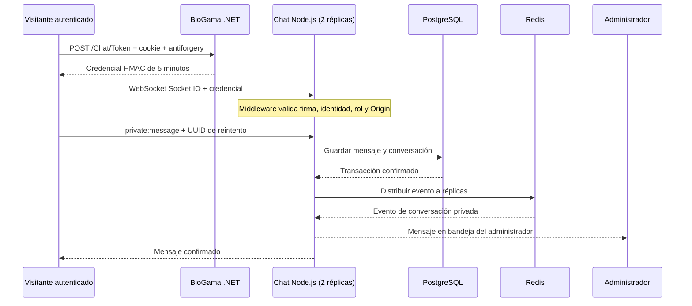

# Chat de atención y colaboración de BioGama

Servicio Node.js + Socket.IO adaptado del chat privado de `Tarea2_Mendoza_Noelia`.
Los visitantes registrados conversan de forma privada con el equipo administrador
sobre productos, cursos o solicitudes para colaborar como investigadores. Escribir
una solicitud no asigna roles ni aprueba la incorporación.

## Qué se reutiliza y qué cambia

Se conserva el enfoque modular de `server/server.js`, los registros de eventos y
acuses de `server/socket/privateMessageHandler.js`, la validación de texto de
`messageService.js` y los patrones de borrador, envío y representación segura de
`public/js/privateMessages.js`. Los archivos del servicio y de la interfaz indican
su procedencia. Se adaptan al protocolo de soporte; no son compatibles directamente
con el chat general de la tarea.

Se sustituye la identificación por nombre libre por credenciales firmadas de
BioGama. Los mapas de conversaciones en memoria se sustituyen por PostgreSQL,
y los eventos entre instancias utilizan el adaptador Redis de Socket.IO. La interfaz
se integra en `/Chat` y la navegación de BioGama, sin iframe ni otro inicio de sesión.
Las llamadas WebRTC, salas públicas, edición, reacciones y recibos de lectura de
la tarea no están incluidos en esta primera versión de soporte.

## Arquitectura



Los administradores autorizados comparten una bandeja. Un visitante solo accede
a su propia conversación, aunque envíe otro `visitorId`. No existe un evento que
permita escoger salas o asignarse roles. La respuesta de soporte se presenta como
«Equipo BioGama». Las consultas están parametrizadas y el contenido se representa
con `textContent`, sin interpretar HTML ni Markdown.

## Persistencia y disponibilidad

El servicio administra únicamente el esquema `biogama_chat` (`threads`, `messages`)
en la misma instancia de PostgreSQL, sin alterar las tablas existentes de EF Core.
La inicialización transaccional usa un bloqueo asesor para coordinar réplicas.
En un entorno de producción se recomienda un usuario PostgreSQL exclusivo con
permisos limitados a este esquema; el laboratorio usa el Secret de la base existente.

Redis distribuye eventos y un límite de 120 solicitudes por usuario/minuto entre
réplicas. PostgreSQL conserva el historial. La interfaz recupera mensajes al
reconectar, al volver a la ventana y cada 30 segundos. Redis Pub/Sub no garantiza
entrega durable: los mensajes se recuperan desde la base. El UUID de envío hace
idempotentes los reintentos con el mismo autor, conversación y contenido.

La primera página contiene los últimos 100 mensajes; el botón permite cargar
anteriores. La bandeja muestra las 100 conversaciones más recientes. El chat
no ofrece notificaciones cuando el navegador está cerrado, presencia ni garantía
de lectura. El acuse confirma persistencia, no que el destinatario haya leído.

## Configuración

Variables del servicio:

| Variable | Uso |
| --- | --- |
| `CHAT_SIGNING_KEY` | Secreto compartido de al menos 32 bytes, generado aleatoriamente |
| `CHAT_ALLOWED_ORIGINS` | Orígenes web exactos, separados por coma, sin comodines |
| `PGHOST`, `PGPORT`, `PGDATABASE`, `PGUSER`, `PGPASSWORD` | Conexión PostgreSQL |
| `REDIS_URL` | Redis compartido por todas las réplicas del chat |
| `PORT` | Puerto del servicio; predeterminado 3000 |

BioGama requiere `Chat__SigningKey` con el mismo secreto y `Chat__PublicUrl` con
el origen público del servicio. Para Docker Desktop se usa
`http://localhost:30082`; la web se abre en `http://localhost:30080/Chat`.
Los manifiestos permiten como Origin tanto localhost:30080 como 127.0.0.1:30080.
El navegador debe alcanzar la URL pública del chat: no usar el nombre DNS interno
de Kubernetes. Cambiar esa URL y los orígenes permitidos para acceso desde otra
máquina. En producción usar HTTPS/WSS en ambos servicios.

Las credenciales solo se mantienen en memoria del navegador, no en URL ni
localStorage. El servidor desconecta al vencer los cinco minutos; el cliente
solicita otra credencial a .NET y recupera el historial. Cerrar sesión o quitar
un rol puede tardar hasta cinco minutos en invalidar una conexión ya autenticada.
La rotación de la clave requiere actualizar ambos servicios y reiniciarlos.
Nunca publicar la clave, tokens, cookies ni contraseñas en Git o evidencias.

## Kubernetes

Crear el Secret `biogama-chat` con la clave `signing_key` antes de aplicar la web.
Ejemplo PowerShell que genera la clave en memoria sin imprimirla:

```powershell
$bytes = New-Object byte[] 48
$rng = [Security.Cryptography.RandomNumberGenerator]::Create()
try { $rng.GetBytes($bytes) } finally { $rng.Dispose() }
$key = [Convert]::ToBase64String($bytes)
$secret = @{
    apiVersion = 'v1'; kind = 'Secret'; type = 'Opaque'
    metadata = @{ name = 'biogama-chat'; namespace = 'biogama' }
    stringData = @{ signing_key = $key }
}
$secret | ConvertTo-Json -Depth 5 -Compress | kubectl apply -f -
$key = $null
$secret = $null
```

Ejecutar esa creación solo si el Secret no existe; no rotarlo en cada arranque.
El Secret de PostgreSQL `biogama-db` debe existir como en el despliegue previo.

```powershell
docker build -t biogama-chat:k8s-v1 chat-service
docker build -t biogama-web:k8s-v11 .
kubectl apply -f k8s/05-chat.yaml
kubectl apply -f k8s/02-web.yaml
kubectl rollout status deployment/biogama-chat -n biogama
kubectl rollout status deployment/biogama-web -n biogama
```

Socket.IO usa exclusivamente WebSocket: no requiere afinidad para HTTP polling.
Ambas réplicas deben usar la misma clave, Redis, base de datos y orígenes. `/health`
comprueba el proceso; `/health/ready` comprueba PostgreSQL y las conexiones Redis.
El contenedor Node se ejecuta sin root, sin privilegios adicionales y con sistema
de archivos de solo lectura. PostgreSQL y Redis siguen siendo instancias únicas;
el laboratorio de un nodo no demuestra tolerancia a una caída completa del nodo.

## Pruebas y evidencia

```powershell
npm.cmd ci --prefix chat-service
npm.cmd test --prefix chat-service
dotnet test tests/BioGamaEcuador.Tests/BioGamaEcuador.Tests.csproj
node --test tests/browser/support-chat.test.cjs
```

La prueba `distributed.test.js` requiere `CHAT_INTEGRATION=1` y PostgreSQL/Redis
accesibles mediante las variables anteriores. Usa dos servidores Socket.IO reales
en puertos locales distintos, adaptador Redis y almacenamiento PostgreSQL reales.
Verifica entrega, aislamiento de un tercer visitante, rechazo de Origin/firma,
idempotencia y recuperación del historial. Limpia solo sus conversaciones de prueba.
Sin esa variable se omite explícitamente la prueba de infraestructura.

Para evidencia visual: abrir la web con una cuenta visitante en un navegador y
con una cuenta administradora en otro. Enviar una solicitud de colaboración,
responder desde la bandeja y comprobar ambos historiales sin recargar. Capturar
las dos ventanas, ocultando correos si corresponde. No confundir pruebas de dos
instancias locales con conexiones a pods distintos: esa afirmación requiere
verificar el campo `pod` del evento `connection:ready` de cada conexión.

Esta incorporación requiere repetir el análisis SonarQube y las pruebas de ZAP
sobre la nueva versión. Los resultados anteriores no evalúan automáticamente el chat.
